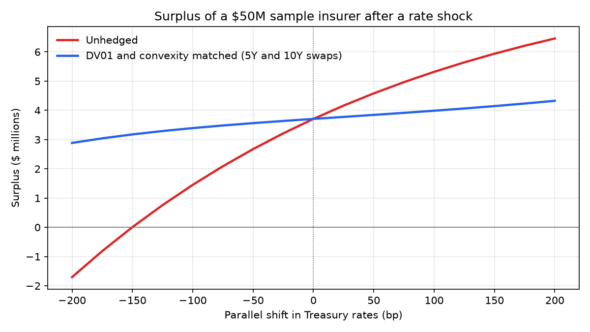

# ALM: how an insurer keeps a rate move from wiping out its capital

A life insurer promises payments decades out and backs them with bonds. When interest rates
move, the two sides of its balance sheet reprice by different amounts, and the difference lands
in surplus, the capital that keeps the company solvent. This repo is a small, tested Python model
of that problem: it builds the liabilities (whole life, an immediate annuity, a fixed indexed
annuity), the assets backing them (Treasuries, corporates, a mortgage loan, private credit), and
the interest-rate swap hedge that keeps surplus stable when rates change.

**Start with the deck:** [Protecting an Insurer's Surplus from Rate Moves](https://realslimslaney.github.io/ALM/quarto/ua_presentation.html),
a guest lecture given at the University of Alabama in February 2026. The
[convexity hedging appendix](https://realslimslaney.github.io/ALM/quarto/convexity-hedging.html)
shows the two-swap solve step by step, and the [documentation site](https://realslimslaney.github.io/ALM/)
has the reference pages.

## The result in one chart



The sample insurer holds $50M of assets against $46.3M of reserves. Its liabilities are longer
than its assets, so a 100 bp fall in rates cuts surplus by more than half. Two swaps sized to
match the DV01 and dollar convexity of the whole-life and annuity book hold surplus within a
narrow band; what remains is the indexed annuity, which sits outside the rate hedge because its
value depends on an equity index.

| Measure | Value |
|---|---|
| Assets (at purchase price) | $50,000,000 |
| Liabilities (whole life, SPIA, FIA reserves) | $46,292,300 |
| Surplus | $3,707,700 |
| Surplus after -100 bp, unhedged | $1,451,624 |
| Surplus after +100 bp, unhedged | $5,317,463 |
| Surplus after -100 bp, hedged | $3,393,426 |
| Surplus after +100 bp, hedged | $3,987,607 |
| Hedge: 5Y and 10Y swap notionals | -$229,079,997 and $145,671,328 (gross $374,751,326) |

Chart and table are produced by `uv run python scripts/make_readme_chart.py` from the same
sample insurer the deck uses (`src/alm/examples.py`), so they cannot drift from it.

## What is in the package

| Module | Contents |
|---|---|
| `alm.asset` | `Bond`, `Mortgage`, `PrivateCredit`: cash flows, present value, Macaulay duration, convexity |
| `alm.liability` | `SPIA`, `WL`, `Term`, `FIA` policies on the SOA 2012 IAM mortality table; net level premiums by the equivalence principle |
| `alm.core` | `InterestRateSwap`, `dv01`, `dollar_convexity`, the two-swap `immunize` solve, `irr`, and `Block` (a portfolio of policies with backing assets by strategic asset allocation) |
| `alm.option` | Black-Scholes-Merton calls and puts, Greeks, implied volatility, and the FIA crediting call spread |
| `alm.read` | Treasury rates and rating-bucket credit spreads from FRED; the SOA mortality tables |
| `alm.examples` | The sample insurer used by the deck and this README |

Every number printed in the deck, the docs and this README is computed by that code; the test
suite (`uv run pytest`, about 330 tests) checks the formulas against textbook values.

## Quick start

Prerequisites: Python 3.12+ and [uv](https://docs.astral.sh/uv/getting-started/installation/).

```bash
git clone https://github.com/realslimslaney/ALM.git
cd ALM
uv sync
uv run pytest
uv run python scripts/run_alm_demonstration.py   # four blocks of business, offline, about a second
```

Rendering the deck needs [Quarto](https://quarto.org/docs/get-started/):
`uv run quarto render quarto/ua_presentation.qmd --to html`. No API key is needed; the credit
spread table is a committed snapshot that only `just refresh-spreads` (with a free FRED key)
rewrites. New to the tooling? See [Environment Setup](docs/how-to/environment-setup.md).

## Simplifying assumptions

This is a teaching model, not a pricing or valuation system. It leaves out, deliberately:

- **Expenses, taxes and regulatory capital.** No acquisition or maintenance expenses, no tax, no
  statutory or risk-based capital.
- **Defaults.** Bond, loan and private-credit default rates are zero, so every yield quoted is a
  promised yield, not an expected return.
- **A yield curve.** A single flat Treasury rate discounts everything; spreads are added to it by
  rating and maturity. There is no term structure, no key-rate risk, and no spread risk.
- **Compounding conventions differ by instrument.** Bonds and swaps are semi-annual, policies are
  monthly, the FIA is annual, all quoted as nominal annual rates.
- **Lapses, surrenders and liquidity.** Policies run to death or maturity; assets are held to
  maturity with no sales, borrowing or rebalancing, and matured proceeds are not reinvested.
- **Mortality.** The SOA 2012 IAM Basic table (an annuitant table) is used for every product,
  with no mortality improvement and no stochastic variation.
- **Single-premium blocks.** A block of business is funded with a loaded net single premium,
  `PV(expected benefits) * (1 + premium_loading)`; level premiums are not projected.
- **Prepayment.** Mortgages are level-payment whole loans with no prepayment option, so they have
  positive convexity (agency MBS would not).
- **The indexed annuity is valued on one index path** and held fixed when rates move; its
  embedded call spread is priced in `alm.option` but not yet used in the deck's hedge.
- **Accrued interest and day counts** are ignored; valuation is at issue only.

## Development

```bash
just check          # ruff lint, ruff format check, pytest
just render         # render the reports in quarto/
just docs-serve     # serve the MkDocs site locally
just refresh-spreads   # rewrite assumptions/credit_spreads.csv from FRED (needs FRED_API_KEY)
```

`AGENTS.md` and `.claude/CLAUDE.md` describe the conventions for AI coding assistants used in
this repo, including the commit gate and the finance rules the code follows. Contributions are
welcome; see [CONTRIBUTING.md](CONTRIBUTING.md).

## License

[MIT](LICENSE)
